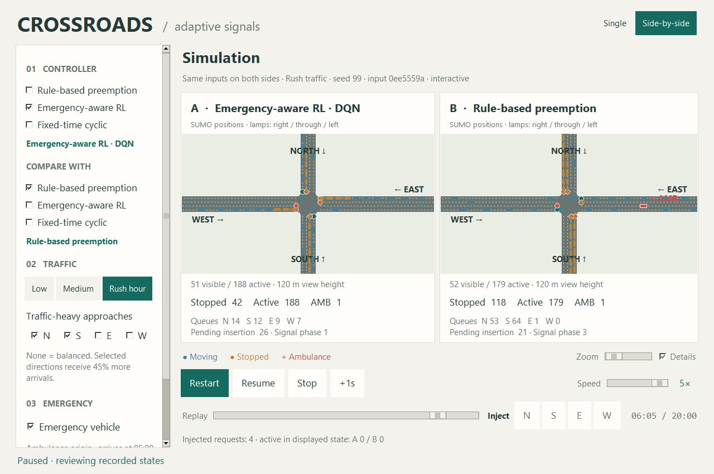

# Adaptive Crossroads RL

**Adaptive traffic signals with emergency vehicle priority**, built with SUMO-RL, Eclipse SUMO and Stable-Baselines3. A native desktop demo lets you configure traffic, inject ambulances, and compare controllers on identical traffic with synchronized playback.

**Dyaus Ghangas · 102308054 · Reinforcement Learning - UCS760**

[Project report](reports/final/Adaptive_Crossroads_Project_Report.pdf) · [Dataset and storage](DATASET.md) · [Reproduction guide](CONTRIBUTING.md)



*Actual SUMO state, captured from an interactive run. This illustration is separate from the held-out benchmark below.*

## What the project does

- Demonstrates fixed-time cyclic signals, rule-based ambulance preemption, standard DQN, and emergency-aware DQN. All switches off explicitly selects standard DQN; the other choices are exclusive.
- Configures Low / Medium / Rush traffic, any combination of heavy approaches, ambulance presence and origin, and a reproducible traffic seed.
- Runs one controller or two separate simulators sharing the exact route, simulator seed and presentation clock. The UI uses the existing v2 seed-0 learned checkpoints.
- Supports Start / Restart, Pause / Resume, Stop, one-second stepping, speed, zoom and replay of recorded history. Interpolation smooths actual vehicle coordinates without modifying raw states or simulation timing.
- Sends genuine ambulance injection requests at shared simulator boundaries. Insertion may wait for entrance space; the interface distinguishes requests from active vehicles.

The research pipeline additionally includes an explicitly identified **Hybrid (Rule+DQN)** controller. It uses rule-based priority within 250m and standard DQN otherwise; its results are not presented as pure learned preemption. The latest UI omits this fifth research controller to keep switch semantics unambiguous.

## Held-out results

Current v2 benchmark: **24 test routes forming 12 normal/emergency pairs**, with learner seeds 0, 1 and 2. Two deterministic baselines plus three seeded learned/hybrid policies produce **264 test episodes**. The table summarizes **ambulance-present cases only**; learned/hybrid rows contain 36 runs, deterministic rows 12.

| Controller | Mean passage (s) | Pooled p95 (s) | Regular stopped wait (s) |
| --- | ---: | ---: | ---: |
| Fixed-time | 98.3 | 316.5 | 64.5 |
| Rule preemption | 38.2 | 106.3 | 61.6 |
| Standard DQN | 75.6 | 215.5 | 35.9 |
| Emergency-aware DQN | 41.4 | 105.2 | 36.8 |
| Hybrid Rule+DQN | 33.5 | 104.5 | 36.6 |

Passage means **250m detection to junction clearance**, not the ambulance's entire journey. Regular stopped wait is an equal-weight average of episode-level means over inserted regular vehicles. Uninserted vehicles are counted separately. The report explains aggregation, censoring and sample sizes.

On these fixed scenarios, emergency-aware DQN reduces mean passage by **45.2% relative to standard DQN**, while rule preemption has a slightly lower passage mean than emergency-aware DQN. Hybrid is strongest on mean passage in this sample, with its deterministic rule contribution explicitly disclosed. These are descriptive simulation results, not significance tests or deployment guarantees.

Across all 264 test runs there were **0 recorded ambulance red crossings, 0 collision events and 0 teleports**, but **4,859 unfinished and 1,416 uninserted regular trips** in aggregate. Therefore the project does not claim to solve gridlock or establish real-world safety. Raw records are in [all_episodes.csv](experiments/v2/main/results/evaluation/test/all_episodes.csv); summaries are in [reported_metrics.json](experiments/v2/main/results/reported_metrics.json).

## Quick start

Tested on **Windows x64, Python 3.12**, with CPU inference. Supplied checkpoints run without retraining. Dependencies require internet during installation; the installed application and benchmark run offline.

```powershell
git clone https://github.com/DyausG/adaptive-crossroads-rl.git
cd adaptive-crossroads-rl
py -3.12 -m venv .venv
& '.venv\Scripts\python.exe' -m pip install --upgrade pip
& '.venv\Scripts\python.exe' -m pip install --extra-index-url https://download.pytorch.org/whl/cpu -r requirements.txt
& '.venv\Scripts\python.exe' app.py
```

After setup, double-click `start.cmd` or run `start.ps1`. No system SUMO installation, database server, API key or external traffic dataset is required. `runtime.py` resolves the installed SUMO package. Native Tk needs a desktop session; this is not a browser app. Linux/macOS installation is not independently verified, and the network regeneration helper currently uses Windows executable names.

## Data and repository layout

**There is no database.** The repository contains all 96 primary route files and a supplementary 72-route experiment set, network geometry, manifests, twelve final checkpoints across both experiment sets, training logs, evaluation CSV/JSON files and the project report. See [DATASET.md](DATASET.md) for split definitions, units, provenance and licensing. `v1` and `v2` are internal experiment/schema identifiers.

```text
app.py, ui_playback.py, ui_scenarios.py    Desktop interface and playback
environment.py, controllers.py           MDP adapter and controller definitions
train.py, evaluate.py                    Training and matched evaluation
experiments/v2/main/
  data/                                 Current paired dataset and network
  models/                               Six 40000-step v2 checkpoints and logs
  results/evaluation/                    Validation/test episodes and traces
  demo/                                  Recorded simulation demonstrations
data/, models/, results/, demo/          Supplementary experiment fixtures and results
reports/final/                           PDF report, editable source and verification evidence
tests/                                  Simulator, data, metric and UI state tests
vendor/sumo-rl/                          Pinned MIT upstream source and needed network assets
docs/images/                            Actual application screenshot
```

Runtime recordings under dated `results/ui_runs/` directories are ignored by Git. They are not benchmark evidence. Experiment statistics and software verification are included under **`reports/final/`**.

## Verification

Run from the repository root using the configured Python environment:

```powershell
& '.venv\Scripts\python.exe' verify_repository.py --replay
& '.venv\Scripts\python.exe' -m pytest tests -q -p no:cacheprovider
& '.venv\Scripts\python.exe' validate_ui.py --screenshots
```

`verify_repository.py` works from a fresh clone: it verifies 168 route hashes and 12 final checkpoints and independently recomputes the primary result table from raw episode records. `--replay` additionally reproduces two supplied policy runs with networking blocked. No parent-directory archives or private files are needed.

Recorded local verification includes **300 pytest tests**, **22 final worker checks**, **24 full desktop checks** and **23 final layout checks**. The desktop checks use real Tk widgets and real SUMO workers, including both controllers reaching 1200 seconds, all four injection directions, pause/seek, Restart, Stop and startup cancellation. [Evidence](reports/final/verification/) is included. The Windows CI definition is supplied as [.github/ci-template.yml](.github/ci-template.yml); it is not active yet. To enable it, use GitHub's web editor to copy its content to `.github/workflows/ci.yml`, or push that path using credentials with workflow permission. No remote CI success is claimed before activation.

To train or evaluate without replacing the supplied experiments, follow [CONTRIBUTING.md](CONTRIBUTING.md). A full fresh dependency installation is separate from verification using the existing tested environment.
