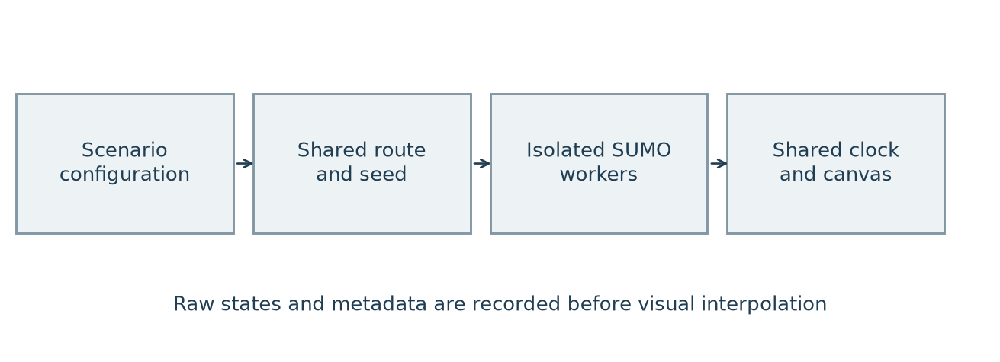
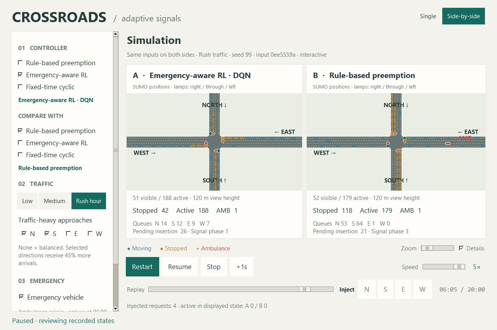
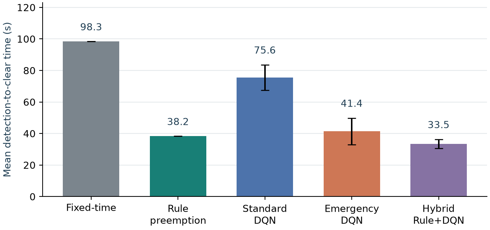
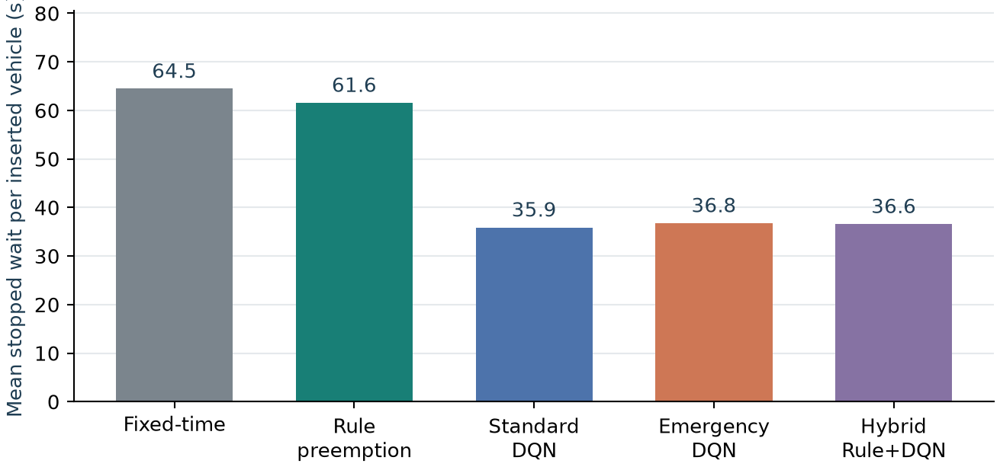

A Project Report submitted for

Reinforcement Learning - UCS760

On

Adaptive Crossroads Control with
Emergency Vehicle Priority

By

Dyaus Ghangas          102308054

Submitted to:

Dr. Himika Sharma

## Certificate

This is to certify that the project report entitled “Adaptive Crossroads Control with Emergency Vehicle Priority”, submitted by Dyaus Ghangas (Roll Number 102308054) to Dr. Himika Sharma, Thapar Institute of Engineering and Technology, Patiala, in fulfilment of the course requirement of Reinforcement Learning (UCS760), presents the design, implementation and experimental evaluation of the project.

The report records the problem formulation, synthetic dataset, trained controllers, simulation application and measured outcomes. The results are supported by the configurations, checkpoints, evaluation records and verification evidence accompanying the project.

Dr. Himika Sharma

Course Instructor, UCS760

Dyaus Ghangas

102308054

## Acknowledgement

I would like to express my sincere gratitude to Dr. Himika Sharma, course instructor for Reinforcement Learning (UCS760), for the opportunity to undertake this project and apply the concepts studied in the course. Developing Adaptive Crossroads Control with Emergency Vehicle Priority provided a practical setting for understanding state design, reward formulation, deep Q-learning and experimental evaluation. I am also grateful to Thapar Institute of Engineering and Technology, Patiala, for the academic environment in which this work was carried out. The project strengthened my understanding of reproducibility, fair controller comparison and the importance of reporting limitations alongside measured results. I thank everyone who supported the completion of the project.

## Introduction

### 1.1 Project Overview

Fixed traffic-signal schedules cannot respond directly to changing demand or an approaching ambulance. This project models a four-way signalized junction in SUMO, formulates signal selection as a Markov decision process, and compares fixed-time control, legal rule-based preemption, standard deep Q-learning, emergency-aware deep Q-learning and an explicitly identified hybrid controller. The study uses 96 synthetic routes arranged as 48 matched normal/emergency pairs, with separate training, validation and held-out test partitions. Six DQN policies are trained for 40000 decisions each. The 264 test episodes include 12 emergency routes per controller and three learner seeds for learned policies. Mean detection-to-clear passage is 98.3 seconds for fixed-time, 38.2 for rule preemption, 75.6 for standard DQN, 41.4 for emergency-aware DQN and 33.5 for hybrid Rule+DQN. Emergency-aware DQN improves the standard DQN mean by 45.2 percent on this test set, but does not outperform rule preemption on that mean. Ordinary-traffic wait and remaining backlog reveal the corresponding tradeoffs. A native desktop application supports reproducible scenarios, genuine live injections, smooth position interpolation and fair synchronized comparisons. All inputs, checkpoints and evaluation records are file-based and included with the project. Results demonstrate behavior in a small synthetic simulation, not real-world safety or general gridlock prevention.


### 1.2 Problem Identification

The project addresses the conflict between predictable ordinary-traffic service and rapid ambulance passage at a signalized crossroads. A fixed cycle may leave an ambulance facing red despite an otherwise serviceable approach. Giving an ambulance priority can shorten its delay while making other approaches wait. An adaptive controller therefore needs information about both network demand and the emergency vehicle, together with a measurable definition of service quality.

The central question is whether an emergency-aware learned policy can reduce ambulance impedance relative to a standard learned traffic controller under identical traffic and legal phase-transition constraints. Fixed-time and rule-based controllers provide interpretable reference points. The hybrid tests the distinct choice of using deterministic emergency priority together with a learned policy for ordinary traffic. It is not treated as a purely learned solution.

### 1.3 Solution Proposed

**Adaptive traffic service:** Formulate signal selection as a reinforcement learning problem using observed lane demand, queue age and phase duration.

**Emergency awareness:** Include ambulance presence and proximity in the state and penalise red/yellow approach impedance, stopping and waiting.

**Fair comparison:** Evaluate fixed-time, rule-based, standard DQN, emergency-aware DQN and hybrid control on identical held-out traffic inputs.

**Reproducible simulation:** Include route manifests, trained checkpoints, configurations, raw evaluation records and verification commands.

**Interactive demonstration:** Display actual SUMO positions using single or synchronized side-by-side playback, with genuine ambulance injections and clean lifecycle controls.

### 1.4 Objectives and Scope

The implementation objectives are to build a valid simulator interface, produce reproducible traffic inputs, train and reload actual policies, evaluate them on reserved scenarios, record ordinary-traffic costs and safety events, and expose the resulting behavior in a usable simulation. Submission includes code, a dataset, models, raw results, test evidence and this report. There is no database service; a file-based structure makes the complete evidence inspectable offline.

The scope is a single four-way junction with synthetic traffic, a fixed evaluation horizon and a small set of trained seeds. The system is an academic simulation rather than a road-infrastructure deployment. No database server, private traffic feed or cloud inference service is required.

### 1.5 Reinforcement Learning Background

Reinforcement learning trains an agent through state observations, actions and rewards rather than through labeled correct actions. In this project the agent requests one of four movement groups at a single junction. Traffic evolves inside SUMO; the environment returns a new observation and reward after a decision interval. Deep Q-learning approximates the value of an action using a neural network. Experience replay and a separate target network reduce the instability associated with correlated observations and a moving training target [1].

SUMO-RL provides the Gymnasium-compatible environment and legal signal transition interface [3]. Stable-Baselines3 supplies the DQN implementation [2]. These are implementation dependencies; the project-specific work defines the traffic scenarios, emergency and fairness observations, reward terms, controller comparisons, evaluation measures and interactive application. SUMO supplies microscopic vehicle dynamics and actual signal, insertion and crossing events [4].

Rule-based preemption is an essential comparator because ambulance priority has a simple, observable trigger: an emergency vehicle approaches a red movement. A learned policy should not be declared successful simply because it beats a fixed cycle. It should also be compared with this direct rule, while measuring how the rule affects regular traffic. The reported results preserve that distinction.

### 1.6 Intended Use and Expected Benefits

**Students and evaluators:** Inspect how traffic demand, controller choice and an approaching ambulance affect phase selection and delay.

**Experimentation:** Reproduce trained-policy results and compare emergency service against ordinary-traffic costs under matching inputs.

**Transparent demonstration:** View exact simulator states, pause or replay history and distinguish an injection request from physical vehicle insertion.

## System Design and Dataset

### 2.1 System Architecture

Figure 1. Runtime data flow. Side-by-side operation sends identical traffic inputs to separate SUMO processes and presents their actual states using one playback clock.



The system has three parts. The experiment pipeline generates traffic, trains policies and writes evaluation records. The simulator adapter constructs observations, applies the shared phase constraints and records telemetry. The native Tk application configures and displays a live run. Separating these parts prevents visual controls or smoothing from changing scientific evaluation data.

| Component | Implementation role |

| --- | --- |

| Scenario generation | generate_routes.py for fixed benchmark inputs; ui_scenarios.py for composable interactive inputs |

| Environment and policies | environment.py, controllers.py, train.py and evaluate.py |

| Desktop presentation | app.py and ui_playback.py |

| Simulation process | sim_worker.py loads an actual checkpoint, advances SUMO and streams JSON states |

| Evidence checks | tests/, verify_repository.py and validate_ui.py |

libsumo has process-level simulation state, so a comparison runs one child process per junction. Worker commands and stdout states travel through queues and pipes. The application only accepts a comparison batch when all workers reach the same simulated second. It also checks scenario identity, route SHA-256 and simulator seed. A failure stops the run instead of silently showing unmatched states.

The simulator network contains a single four-way junction with incoming approaches extended to approximately 389.6m. This places a complete 250m emergency detection window inside the network. Connections and signal links define the actual permitted turns. The canvas reads network lane geometry and real vehicle coordinates rather than placing illustrative markers on arbitrary paths.

### 2.2 Dataset and Traffic Generation

The primary dataset contains 96 synthetic route files arranged as 48 normal/emergency pairs. Each background seed generates identical regular-vehicle schedules and simulator seeds for the paired cases. Ambulance timing uses an independent random stream, so adding an emergency vehicle does not change the regular-arrival draws. These are simulation inputs, not measured city traffic.

Table 1. Primary dataset partition. Each pair contains the same regular traffic with and without an ambulance.

| Partition | Background seeds | Pairs | Routes |

| --- | --- | --- | --- |

| Training | 10000-10023 | 24 | 48 |

| Validation | 20000-20011 | 12 | 24 |

| Held-out test | 30000-30011 | 12 | 24 |

| Total | Disjoint partitions | 48 | 96 |

Low, medium and rush demand use Poisson rates of 0.055, 0.12 and 0.21 vehicles per second per approach. Patterns are symmetric, north/south-heavy or east/west-heavy. The heavy axis receives a 1.45 multiplier and the other axis 0.55, preserving total expected demand. Vehicles choose straight travel with probability 0.8 and each other destination with probability 0.1. Regular arrivals stop at 900s; episodes end at 1200s.

Requested ambulance departure is between 240s and 420s, with early and late timing windows. Each 12-pair block balances direction, demand and imbalance. It is not a full factorial: all four directions, three levels and three imbalances would require 36 combinations before replication. The compact design cannot identify every interaction.

Learner seeds 0, 1 and 2 are separate from traffic seeds, and train/validation/test inputs are disjoint. Final checkpoints use a fixed 40000-decision budget. Each validation and test split contains 24 routes times (2 deterministic policies + 3 policies times 3 model seeds), giving 264 episodes. The emergency-present results use 132 of these records.

Manifests record configuration, vehicle count, split, seed, input path and SHA-256. DATASET.md also identifies supplementary integrity/regression fixtures. Interactive scenarios are stored separately and excluded from held-out statistics.

## Learning Methodology

### 3.1 State action and transition

The standard observation has 26 normalized features. The base 21 features encode the active phase, whether its minimum green time has elapsed, incoming-lane density and halting queues. Four additional features encode maximum regular-vehicle waiting age on each approach, capped and normalized at 120s. One feature encodes elapsed phase duration relative to the maximum-green limit. Queue age makes low-flow approaches visible even when their queues are short.

The emergency-aware observation adds eight features, producing 34 dimensions. Each direction contributes an ambulance-presence flag and maximum proximity inside 250m. Proximity is one minus distance divided by 250, clipped to zero through one. Only incoming ambulances with the junction as their next signal are considered. Both policies use the same discrete action space: north/south through and right, north/south protected left, east/west through and right, or east/west protected left.

Decisions occur every 5 simulated seconds. Requests pass through a shared state machine with 3s yellow, 10s minimum green and a 60s maximum-green setting. A request does not instantly bypass an ongoing phase. These timing settings constrain every controller identically. Ambulances retain speedMode 31, and the project does not enable a bluelight device or red-light bypass.

### 3.2 Reward and training objective

The standard reward is the upstream difference in accumulated waiting-time reward, minus 0.15 times the sum of normalized maximum approach waits. The emergency-aware reward subtracts an additional penalty for each detected ambulance: 1.5 times (1 + proximity) when its movement is not green, plus 2 when stopped, plus 0.04 times its waiting time capped at 120s. The red/yellow approach penalty supplies a signal before the ambulance is fully stopped. These coefficients are design choices and are not established as globally optimal.

```text
standard reward = difference in waiting-time reward
                  - 0.15 * sum(normalized approach waits)
emergency reward = standard reward
                   - sum(red/yellow approach + stop + wait penalties)
DQN nonterminal target = reward + gamma * max Q_target(next_state, action)
```

DQN minimizes the discrepancy between its estimated action value and the target based on observed reward and the target network. Epsilon-greedy exploration allows phase choices beyond the current greedy estimate during training. Evaluation uses deterministic model prediction. Reward curves of standard and emergency policies cannot be compared as domain performance scores because their reward definitions differ; passage, traffic delay and backlog provide the common measures.

### 3.3 Controllers and Training Configuration

Table 2. Evaluated policies. Rule-based priority embedded in the hybrid is explicitly part of that controller.

| Controller | Decision rule |

| --- | --- |

| Fixed-time | Requests four movement groups in an 80s cycle with nominal slots 25/15/25/15s, subject to the common legal transition state machine. |

| Rule preemption | Requests a green-compatible phase for the nearest approaching ambulance within 250m; uses the fixed cycle when none is detected. |

| Standard DQN | Learns from the 26-feature state and ordinary-traffic reward without emergency-specific features or penalties. |

| Emergency-aware DQN | Learns from the 34-feature state and emergency-aware reward. |

| Hybrid Rule+DQN | Uses rule preemption within the detection window and the matched-seed standard DQN otherwise. No separate hybrid network is trained. |

Table 3. Configuration recorded with each of the six primary checkpoints.

| Parameter | Recorded value |

| --- | --- |

| Network | MLP with two hidden layers of 64 units |

| Learning rate / discount | 0.0005 / 0.99 |

| Replay capacity / learning starts | 50000 transitions / 1000 decisions |

| Batch / training frequency | 64 / every 4 decisions, one gradient step |

| Target update interval | 500 decisions |

| Exploration | Epsilon 1.0 to 0.05 over the first 35% of the budget |

| Budget / learner seeds | 40000 decisions per model / 0, 1, 2 |

| Execution | CPU; one PyTorch training thread; deterministic evaluation |

The six primary models completed a total of 240000 decisions. Their recorded training times range from 75.66s to 82.43s, totaling 481.31 process-seconds. These are machine-specific recorded run timings, not a promise for a fresh machine. Every final checkpoint was reloaded and used for a valid prediction. Configuration files record observation schema, feature count, learner seed, input-manifest hash and library version to reject incompatible checkpoint/state combinations.

### 3.4 Application Implementation

The interface centers on a large junction view with compact telemetry below it. Single mode uses one policy; Side-by-side uses two independent workers synchronized on the same traffic. Controller switches are exclusive because the supported policies are distinct. When all switches are off, the interface explicitly labels standard DQN. Fixed-time, rule preemption and emergency-aware RL are selectable without implying a nonexistent combined policy.

Traffic controls select low, medium or rush demand; any subset of heavy approaches; ambulance presence; and its origin. In interactive scenarios, each selected direction receives 45 percent more arrivals without reducing the other directions. None selected means balanced expected demand. The scheduled interactive ambulance requests departure at 300s. The traffic seed controls route generation and simulator randomness; the displayed learned policy uses checkpoint seed 0. Interactive traffic is not mixed with held-out benchmark statistics.

The app advances actual SUMO states one second at a time and interpolates positions and shortest-angle heading changes between consecutive states. Signal changes, vehicle creation/removal and telemetry retain their true state boundaries. Pause freezes the current visual interpolation; resume continues from it. Seeking displays recorded history and pauses both views. It does not rewind or branch a running simulator, and it cannot seek into an uncomputed future.

Live injection sends the same ambulance request to both workers at a shared boundary. The worker acknowledges a request before physical insertion; SUMO may delay insertion if a lane is occupied. The app reports active ambulances from the displayed actual state, avoiding an artificial emergency animation. Stop closes workers and waits asynchronously for cleanup, with termination as a bounded fallback. Restart waits for prior processes to retire, clears playback state and applies pending configuration changes.

### 3.5 Simulation Workflow

The application presents the same generated traffic in both views. Each controller runs in its own SUMO process and advances through a common time barrier. Vehicle colours, signal indicators and telemetry describe the actual displayed state.

Figure 4. Actual application capture showing emergency-aware DQN and rule-based preemption at the same simulation time. This interactive demonstration is separate from the held-out evaluation.



Configure the traffic level, focused approaches, emergency vehicle and controller selections.

Start the run, use the shared playback controls and inspect the live junction.

Inject an ambulance at the live edge or pause and replay recorded states.

Stop the workers cleanly, or restart to apply a new configuration.

## Experimental Evaluation

### 4.1 Evaluation Measures and Protocol

**Ambulance passage** is the interval between first detection inside 250m and first observation on an outgoing road. It is neither total journey time nor requested-departure-to-clear time. The latter also includes insertion delay and travel before detection. Reporting both prevents a controller from appearing better simply because an ambulance entered the simulated network later.

**Ordinary-traffic stopped wait** is accumulated stopped vehicle-seconds divided by inserted regular vehicles within an episode, then averaged equally across episodes. It includes observed waiting of unfinished inserted trips, but excludes vehicles that never entered. The stopped-plus-pending congestion measure integrates stopped and pending counts over the horizon and divides by requested vehicles. Unfinished and uninserted counts remain visible to expose horizon and congestion effects.

**Queue recovery** begins at clearance and uses a threshold of max(1, 1.1 times the mean queue in the preceding 60s before emergency detection). Recovery requires 15 consecutive one-second samples at or below that threshold. Episodes with no observed recovery before 1200s are right-censored and cannot be treated as zero or dropped silently. Excess queue area integrates queue above the threshold for up to 120s after clearance.

Reported passage means pool the completed emergency episodes within a controller. The p95 is the 95th percentile of pooled episode passages using linear interpolation, not the average of per-seed p95 values. For learned controllers, the reported seed standard deviation is the sample standard deviation of the three seed means. It is not a confidence interval, and 36 episode records are not 36 independently trained agents. No hypothesis test or statistically significant superiority is claimed.

Matching background inputs enables controlled within-simulation comparisons, including emergency-minus-normal delay. The stochastic simulator can still diverge after interventions affect traffic interactions. Results describe this fixed scenario family. Different demand patterns, pedestrian traffic, sensor noise or a larger road network may change the ranking.

### 4.2 Held Out Results and Statistical Analysis

Table 4. Ambulance-present test episodes only. Means and p95 describe the same fixed held-out route family; deterministic baselines have no learner-seed replication.

| Controller | Runs | Mean (s) | Pooled p95 (s) | Scheduled to clear (s) |

| --- | --- | --- | --- | --- |

| Fixed-time | 12 | 98.3 | 316.5 | 134.4 |

| Rule preemption | 12 | 38.2 | 106.3 | 74.3 |

| Standard DQN | 36 | 75.6 | 215.5 | 94.0 |

| Emergency DQN | 36 | 41.4 | 105.2 | 56.3 |

| Hybrid Rule+DQN | 36 | 33.5 | 104.5 | 51.9 |

Figure 2. Mean ambulance passage. Error bars for learned/hybrid policies show sample SD of three learner-seed means; the deterministic baselines have no learner-seed error bar.



Emergency-aware DQN achieves a mean passage of 41.4s versus 75.6s for standard DQN, a descriptive reduction of 45.2 percent on the same held-out traffic. Its pooled p95 is 105.2s versus 215.5s for standard DQN. This is consistent with the intended effect of adding emergency state and reward information, but the experiment changes both together and therefore does not isolate which component causes the difference.

Rule preemption reaches 38.2s mean passage, slightly lower than emergency-aware DQN. The learned policy should therefore not be presented as the best ambulance-priority controller on mean passage. Hybrid reaches 33.5s, but its priority logic is explicitly rule-based; the learned component operates outside the detection window. Tail values also matter: all three emergency-priority methods have pooled p95 near 105-106s, far above their means.

Table 5. Seed-level passage means, each averaged over the same 12 emergency routes.

| Learned policy | Seed 0 mean (s) | Seed 1 mean (s) | Seed 2 mean (s) | Seed SD (s) |

| --- | --- | --- | --- | --- |

| Standard DQN | 77.4 | 82.5 | 66.8 | 8.0 |

| Emergency DQN | 33.6 | 40.2 | 50.3 | 8.4 |

| Hybrid Rule+DQN | 36.7 | 32.4 | 31.3 | 2.8 |

Figure 3. Regular-vehicle stopped wait in the emergency-present test cases. These are equal-weight averages of episode means over inserted regular vehicles; uninserted demand is accounted for separately.



Table 6. Ordinary-traffic outcomes in ambulance-present episodes. Learned/hybrid count totals pool three model seeds; deterministic totals cover one run per route and must not be compared as equal-exposure event rates.

| Controller | Stopped wait (s) | Congestion (s/request) | Unfinished | Uninserted |

| --- | --- | --- | --- | --- |

| Fixed-time | 64.5 | 95.1 | 478 | 337 |

| Rule preemption | 61.6 | 91.3 | 440 | 298 |

| Standard DQN | 35.9 | 45.7 | 451 | 1 |

| Emergency DQN | 36.8 | 47.6 | 517 | 61 |

| Hybrid Rule+DQN | 36.6 | 45.2 | 431 | 0 |

Emergency-aware DQN averages 36.8s ordinary stopped wait, close to standard DQN at 35.9s and below rule preemption at 61.6s. This illustrates the intended tradeoff: the rule has a slightly better mean ambulance passage, while the learned traffic policies show lower average stopped delay for inserted ordinary vehicles. Means alone are insufficient because congested cases can leave vehicles pending or unfinished.

Across all 264 test episodes, including normal cases, there are 4859 unfinished regular trips and 1416 scheduled regular vehicles that never enter before the horizon. There are no incomplete ambulance passages among the 132 emergency episodes. Recorded ambulance red crossings, collisions and teleports are all zero in this evaluation. These findings do not mean all demand was served or that gridlock is impossible. One rule-preemption queue-recovery episode is censored; the other controllers have no recovery censoring in their emergency test records.

Mean post-clearance excess queue area over 120s is 1177.4 vehicle-seconds for fixed-time, 1089.9 for rule preemption, 697.4 for standard DQN, 533.3 for emergency-aware DQN and 707.4 for hybrid. This measure captures residual congestion after emergency clearance. Its ranking differs from mean passage, reinforcing the need to report more than one outcome.

### 4.3 Implementation Difficulties and Resolutions

Table 7. Engineering problems, implemented responses and observable checks. These are implementation decisions, not ablation results proving each individual performance contribution.

| Problem encountered | Resolution and evidence |

| --- | --- |

| Short queues can hide long waiting age | Added maximum approach-wait features and an elapsed-phase feature, together with a starvation penalty. The observation/schema tests verify dimensions and bounded features. |

| Emergency reward can arrive too late if tied only to stopping | Included proximity-conditioned red/yellow approach impedance before a complete stop, alongside stop and waiting penalties. Reward tests distinguish approaching-red and green cases. |

| Ambulance presence could change background traffic draws | Used independent random streams for regular traffic and ambulance timing. Pairing tests check exact equality of ordinary vehicle schedules. |

| Two comparisons could drift or share simulator state | Isolated libsumo workers and accepted only equal-time state batches with matching input hashes and traffic seeds. All ordered controller pairs were exercised. |

| One-second snapshots produced visibly stepped movement | Interpolated only presentation coordinates/headings, retaining immutable raw traces and discrete state boundaries. Pause and seek tests verify stable positions and history preservation. |

| An acknowledged injection was not always physically inserted immediately | Separated request status from active-vehicle counts and advanced actual simulator states until lane space permitted insertion. No forced insertion or bypass was introduced. |

| Small windows and repeated runs could hide controls or leave work active | Reserved playback controls before the expandable viewport, added scrolling configuration, made headings responsive, tracked the UI timer and reaped child processes before restart. Desktop checks cover minimum size and startup cancellation. |

A worker regression test initially used a 45s cold-start deadline while the application allowed 90s. Concurrent imports caused one intermediate timeout. The test was aligned with the app deadline and cancellation was distinguished from normal graceful exit. The final targeted rerun passed all 22 selected worker checks. Cold import time remains dependent on machine load; cancellation keeps the UI responsive during startup.

### 4.4 Verification and Reproducibility

Table 8. Verification scopes overlap; counts are separate recorded runs and should not be added as independent experiments. Primary experiment performance comes from the 264 held-out episodes, not UI tests.

| Verification | Recorded result |

| --- | --- |

| Complete simulator/data/state test suite | 300 tests passed |

| Final actual-worker rerun | 22 selected checks passed |

| Full native desktop integration | 24 checks passed, including two simulations completing 1200s |

| Final layout and interaction run | 23 checks passed; captures inspected at 1280x850 and 1040x720 |

| Repository evidence audit | 168 included routes and 12 final checkpoints checked; primary result summaries independently recomputed from raw episodes |

| Offline replay | Two archived policies reproduced their recorded metrics with external connections blocked |

A file-based repository supports offline inspection. The primary dataset is under experiments/v2/main/data; trained models and run configurations are under its models directory; validation and test CSV/JSON records are under results/evaluation. Manifest and checkpoint hashes connect the evaluated runs to exact inputs and policies. No SQLite, SQL, MongoDB or other database is used. Generated interactive routes and recordings are kept separate from the versioned benchmark inputs.

The installed project was tested on Windows x64 with Python 3.12, SUMO/libsumo 1.28.0, Stable-Baselines3 2.9.2, PyTorch 2.14.1+cpu and the pinned dependency set. The application is native Tk, so browser testing does not apply. Internet is needed to install dependencies; installed simulation and inference run offline. A full dependency installation on every supported operating system is not claimed. A Windows CI workflow template is included for activation in GitHub Actions. Its presence does not establish a successful remote CI run; the README explains activation.

```text
python -m pip install --extra-index-url
  https://download.pytorch.org/whl/cpu -r requirements.txt
python app.py
python verify_repository.py --replay
python -m pytest tests -q -p no:cacheprovider
python validate_ui.py --screenshots
```

The first installation command is wrapped for printing; enter it as one line. Supplied checkpoints run without retraining. For new experiments, training supports a separate output group and evaluation supports a separate output root. The contribution guide documents these options so an evaluator need not overwrite supplied evidence. The report builder independently recomputes its numeric evidence before generating the PDF and editable Markdown source.

### 4.5 Limitations and Further Work

The experiment uses one synthetic four-way network, Poisson demand, limited directional patterns and three learner seeds. It omits pedestrians, coordinated junctions, realistic emergency dispatch, noisy sensing and changing road geometry. The compact balanced design does not cover every interaction among direction, intensity and imbalance. Hyperparameter/reward ablations and independent network replication are needed before assigning performance changes to an individual feature or generalizing the controller ranking.

The finite horizon creates unfinished and uninserted ordinary trips. Their counts and the pending-aware congestion metric should remain visible whenever mean delay is quoted. Zero observed simulation safety events do not establish real-world safety. The multiple-ambulance sandbox is a visual experiment: existing passage/recovery tracking follows the first observed ambulance, so these interactive events do not establish a validated multi-ambulance benchmark. Straight interpolation between one-second positions also approximates motion during turns; raw endpoints remain exact.

The project demonstrates a measurable emergency-aware learned policy with lower mean ambulance passage than standard DQN on controlled held-out traffic, alongside lower ordinary stopped delay than the direct preemption rule. The rule still has the lower mean ambulance passage of those two policies, and the hybrid achieves the best mean passage in this sample with its explicit rule component. This supports a practical comparison of priority and ordinary-traffic service rather than a claim that learning dominates every baseline.

Further work should test independent networks and non-Poisson demand, add explicit pedestrian and transit constraints, validate multiple ambulances with per-vehicle metrics, compare additional RL algorithms under equal budgets, perform feature/reward ablations, and expand seed replication. Those are proposed extensions, not completed capabilities of this submission.

## Reflections

Working on Adaptive Crossroads Control with Emergency Vehicle Priority connected reinforcement learning theory with the practical demands of a complete simulation system. Designing the observation and reward made the control objective concrete: short queues do not always mean fair service, and an ambulance can be impeded before it comes to a complete stop. These considerations motivated explicit waiting-age and emergency-proximity information rather than relying only on total traffic load.

An important lesson was that a learned controller must be assessed against strong and understandable alternatives. Emergency-aware DQN reduced mean ambulance passage relative to standard DQN in the held-out scenarios, while rule-based preemption retained a slightly lower passage mean. The learned policies also showed lower ordinary stopped wait than the rule. Reporting this tradeoff was more informative than presenting one favourable score as a universal improvement.

The implementation also demonstrated why experimental integrity and interface behaviour must be considered together. Matching traffic seeds is not sufficient if two displays drift in time, and acknowledging an injection is not the same as observing the ambulance in the network. Separate simulation workers, state barriers, immutable recordings and explicit request/active counts made these distinctions observable. Smooth playback improved the presentation while preserving actual simulator endpoints and event ordering.

The final outcome is a working academic project with an inspectable dataset, trained models, a simulation application and reproducible results. The project strengthened my understanding of deep Q-learning, controlled evaluation, finite-horizon metrics and software verification. It also made the limits clear: synthetic single-junction evidence and zero observed simulator safety events do not establish real-world safety or guarantee gridlock prevention. Further experiments on independent networks and more diverse traffic remain necessary.

## References

[1] V. Mnih et al. Human-level control through deep reinforcement learning. Nature 518, 529-533, 2015. DOI 10.1038/nature14236. https://doi.org/10.1038/nature14236

[2] A. Raffin, A. Hill, A. Gleave, A. Kanervisto, M. Ernestus and N. Dormann. Stable-Baselines3: Reliable Reinforcement Learning Implementations. Journal of Machine Learning Research 22(268), 1-8, 2021. https://www.jmlr.org/papers/v22/20-1364.html

[3] L. N. Alegre and contributors. SUMO-RL source and documentation. Pinned revision 86f0fc41401eeca724b2e8878f5020dc6d70c9b4. MIT license. https://github.com/LucasAlegre/sumo-rl

[4] Eclipse SUMO. Traffic lights, TraCI, libsumo and emergency-vehicle documentation. Runtime version 1.28.0. https://sumo.dlr.de/docs/

[5] Project experiment records. experiments/v2/main/config.json; data/manifest.json; models/*/config.json and run.json; results/evaluation/test/all_episodes.csv; results/reported_metrics.json. Included in the repository.

[6] Project verification records. reports/final/report_evidence.json; reports/final/software_verification.json; tests/; validate_ui.py; verify_repository.py. Included in the repository.

Documentation references accessed 18 November 2026. Local MIT and third-party notices identify the terms applying to project files and installed dependencies. Dataset descriptions and conclusions concern the synthetic simulation only.